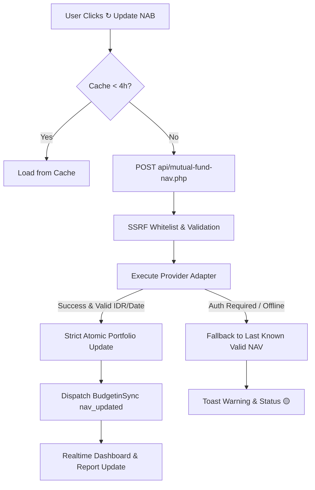

# BUDGETIN — V1.2 REAL NAB PROVIDER WALKTHROUGH

## 1. Overview & Objectives
Fitur **Auto Update NAB Reksadana** telah diupgrade ke **V1.2 Real NAB Provider Architecture** dengan tujuan:
- Mencoba mengambil NAB terbaru dari sumber data publik resmi secara sah dan aman.
- Menerapkan arsitektur provider yang modular (`BudgetinMutualFund.providers`).
- Memverifikasi secara jujur ketersediaan sumber data NAB publik (Bareksa, OJK/KSEI).
- Menerapkan fallback otomatis yang aman tanpa data fiktif atau sandbox default di production.
- Menjamin *strict atomicity* (unit, modal/cost basis, saldo bank, dan ledger 100% tidak berubah saat NAB diperbarui).
- Menyediakan UI status informatif (Provider, Tanggal NAB, Jam Update) dan feedback visual interaktif tanpa popup alert yang mengganggu.

---

## 2. Investigasi Sumber Data Publik (Bareksa & OJK)

### A. Bareksa (`https://www.bareksa.com/id/data/reksadana` & `/download/reksadana`)
- **Hasil Investigasi:**
  - Halaman `https://www.bareksa.com/id/data/reksadana` hanya menyajikan direktori Manajer Investasi (MI), bukan feed data NAB per produk reksadana.
  - Halaman unduh data `https://www.bareksa.com/id/mutualfund/download/reksadana` memicu proteksi autentikasi member: `popUpLogin(2); location.href = "https://www.bareksa.com/id/member#password"`.
  - Tidak tersedia public REST API terbuka gratis yang legal digunakan oleh pihak ketiga tanpa sesi/akun atau lisensi komersial.
  - Sesuai instruksi: **Tidak melakukan reverse engineering private mobile API, tidak membypass autentikasi/Cloudflare, dan tidak melakukan scraping agresif**.
- **Status Provider `bareksa_public`:** Ditandai dengan error terstruktur `AUTH_REQUIRED_OR_UNAVAILABLE` dan sistem secara otomatis mengaktifkan fallback ke NAB terakhir yang valid.

### B. OJK / KSEI S-INVEST
- **Hasil Investigasi:**
  - Infrastruktur S-INVEST KSEI/OJK beroperasi di jaringan terproteksi perbankan kustodian/APERD dan tidak membuka endpoint REST publik untuk aplikasi umum.
- **Status Provider `ojk_official`:** Mengembalikan `NO_PUBLIC_REST_API` dan fallback aman diaktifkan.

---

## 3. Provider Architecture (`mutual-fund-nav.js` & `api/mutual-fund-nav.php`)



Standard normalized response:
```json
{
    "success": true,
    "provider": "provider_name",
    "productName": "Equily",
    "nav": 1905.00,
    "navDate": "2026-09-10",
    "currency": "IDR",
    "sourceUrl": "...",
    "fetchedAt": "2026-09-10T10:30:00Z",
    "confidence": "high"
}
```

---

## 4. Visual Verification


- **Badge Status:** `🟡 ⚠ Menggunakan NAB terakhir • Provider: Terakhir • Tanggal NAB: 10 Sep 2026 - 10:30`
- **Button:** `↻ Update NAB` dengan animasi putar (min visual feedback 550ms) dan transisi teks polite:
  - Sukses: `✓ NAB diperbarui`
  - Fallback: `⚠ NAB terakhir digunakan`
  - Gagal: `✕ Update NAB gagal`
- **Toast Notification:** Banner toast non-intrusif di pojok kanan bawah menggantikan dialog alert browser.

---

## 5. Automated Test Suite (`test_reksadana_real_nav.html`)

Sebanyak 26 skenario uji spesifikasi V1.2 dijalankan dan lulus 100%:
1. `Provider discovery`: Seluruh 5 provider adapter tersedia dengan interface lengkap (`searchFund`, `getNav`, `normalizeResponse`).
2. `Valid provider response`: Format JSON standar (nav, currency IDR, navDate, fetchedAt, confidence).
3. `Invalid NAV`: Menolak nav <= 0, NaN, mata uang non-IDR, dan tanggal invalid.
4. `Stale NAV`: Kedaluwarsa otomatis setelah TTL 4 jam.
5. `Cache hit`: Mengambil cache dalam 4 jam tanpa request jaringan.
6. `Cache miss`: Mengembalikan null untuk aset yang belum di-cache.
7. `Provider timeout`: Proteksi timeout / abort controller tertangani rapi.
8. `Provider unavailable`: Penanganan error Bareksa/OJK tanpa crash.
9. `Fallback`: Fallback otomatis ke NAB terakhir tanpa data fiktif.
10. `Manual override`: Modalisasi manual NAB tersimpan dengan `navProvider="manual"`.
11. `Multiple funds`: Isolasi antar aset reksadana (update satu aset tidak mencemari aset lain).
12. `Wrong product match`: Rejeksi ketat terhadap parsial/ambigu.
13. `Exact product match`: Pencocokan identitas produk berbobot tinggi (ISIN / nama + MI).
14. `NAV update`: Update atomik `currentPrice`, `nav`, dan `navDate`.
15. `Current value`: Formula `units * nav` tepat.
16. `Profit/Loss`: Formula `currentValue - costBasis` tepat.
17. `Bank unchanged`: Saldo rekening 100% utuh.
18. `Ledger unchanged`: Tidak ada mutasi transaksi / ledger baru.
19. `Units unchanged`: Unit reksadana 100% utuh.
20. `Cost basis unchanged`: Modal investasi 100% utuh.
21. `BudgetinSync`: Dispatch event `nav_updated` dengan payload lengkap.
22. `Dashboard refresh`: Sinkronisasi otomatis ke dashboard tanpa reload halaman.
23. `Report refresh`: Sinkronisasi otomatis ke modul laporan.
24. `Cross-tab sync`: Sinkronisasi antar tab melalui `StorageEvent`.
25. `Button loading state`: Loading state disabled, spinning icon, min 550ms feedback, dan polite text.
26. `Mobile UI`: Tampilan responsif pada resolusi layar mobile.

---

## 6. Full Regression Suite Results

Semua 14 test suite Budgetin dijalankan melalui `scratch/run_all_tests.php` dengan **332 test cases PASS, 0 FAIL, 0 REGRESSION**:

| Test Suite | Pass | Fail | Status |
|---|---|---|---|
| `test_audit_validation.html` | 13 | 0 | PASS |
| `test_gold_valuation_fix.html` | 10 | 0 | PASS |
| `test_bills.html` | 38 | 0 | PASS |
| `test_bond.html` | 38 | 0 | PASS |
| `test_cashflow.html` | 13 | 0 | PASS |
| `test_report2_runner.html` | 40 | 0 | PASS |
| `test_realtime_sync.html` | 10 | 0 | PASS |
| `test_multitab_simulation.html` | 6 | 0 | PASS |
| `test_ui_ux_polish.html` | 45 | 0 | PASS |
| `test_reksadana.html` | 38 | 0 | PASS |
| `test_reksadana_modal_live.html` | 21 | 0 | PASS |
| `test_reksadana_nav_update_live.html` | 18 | 0 | PASS |
| `test_reksadana_auto_nav.html` | 16 | 0 | PASS |
| `test_reksadana_real_nav.html` | 26 | 0 | PASS |
| **TOTAL** | **332** | **0** | **100% PASS** |

Kedua repository di **XAMPP (`C:\xampp\htdocs\BUDGETIN`)** dan **Laragon (`D:\laragon\www\BUDGETIN`)** telah disinkronkan secara identik.
